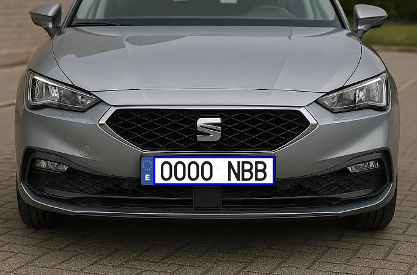
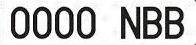
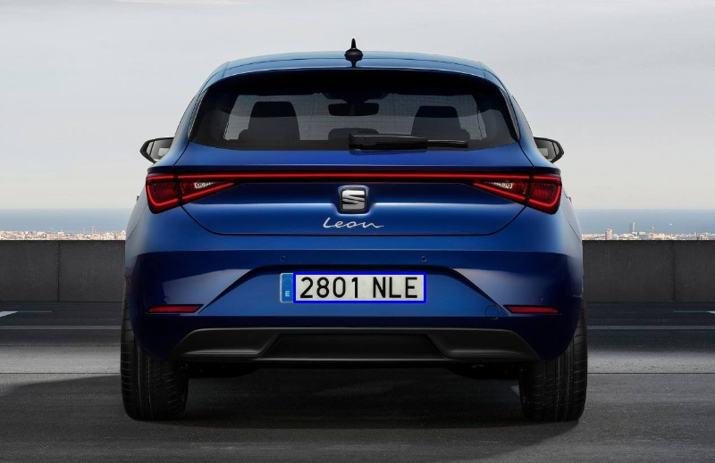
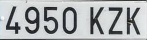
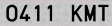
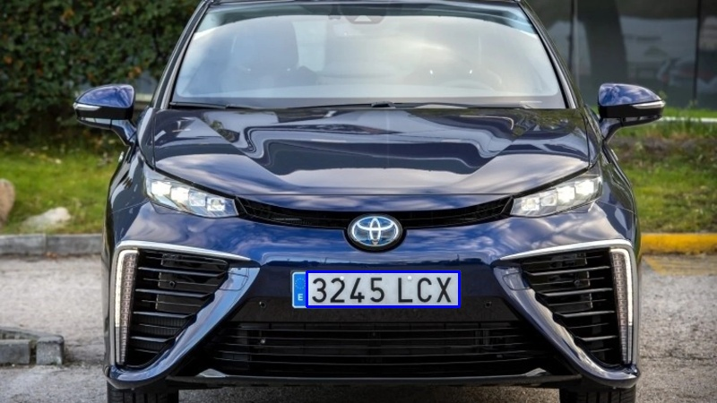

# TFG

## Fase 1: Detección de matrículas de vehículos

El programa detecta la matrícula en la imagen de un vehículo y recorta la región identificada para su posterior reconocimiento.

A continuación se muestran los resultados de cinco pruebas, desde la **detección de la matrícula** hasta la **imagen recortada**.

| Matrícula detectada en el vehículo |  | Matrícula recortada |
| :---: | :---: | :---: |
| **Vehículo 1**  | ➜ |  |
| **Vehículo 2**  | ➜ |  |
| **Vehículo 3**  | ➜ |  |
| **Vehículo 4**  | ➜ |  |
| **Vehículo 5**  | ➜ |  |
