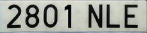
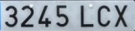

# TFG

## Fase 1: Detección y reconocimiento de matrículas de vehículos

En esta primera fase se ha desarrollado un sistema capaz de detectar y localizar matrículas en imágenes de vehículos mediante **OpenCV**.

Una vez identificada la matrícula, se recorta y se procesa mediante **Tesseract OCR**, que reconoce los caracteres y los convierte en una cadena de texto (`String`) en Java.

**Proceso:** Imagen del vehículo → Detección de matrícula → Recorte → OCR → String

### Resultados de las pruebas

| Matrícula detectada | | Matrícula recortada | | Resultado OCR (`String`) |
|:---:|:---:|:---:|:---:|:---:|
|  | ➜ |  | ➜ | `0000NBB` |
|  | ➜ |  | ➜ | `2801NLE` |
|  | ➜ |  | ➜ | `4950KZK` |
|  | ➜ |  | ➜ | `0411KMT` |
|  | ➜ |  | ➜ | `3245LCX` |

### Resultado de la fase 1

**Fase 1 completada.**

Se ha implementado y probado correctamente el proceso de detección, recorte y reconocimiento de matrículas.

El sistema obtiene la matrícula como una cadena de texto (`String`), que podrá utilizarse posteriormente para consultar la base de datos y determinar si el vehículo está autorizado a acceder al aparcamiento.
